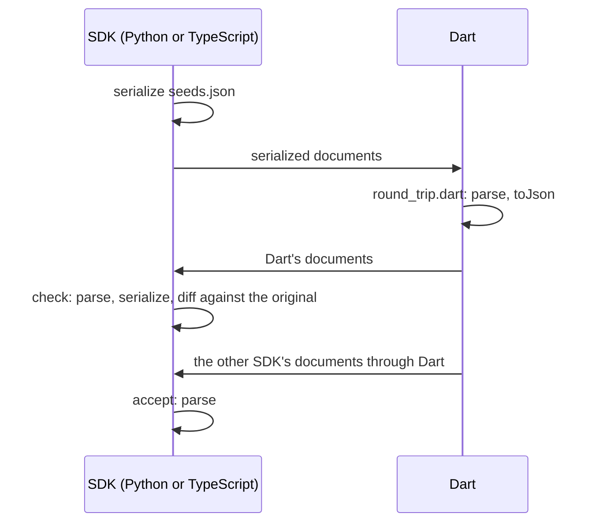

# Cross-SDK round trip

Checks that the data model survives Python → Dart → Python and
TypeScript → Dart → TypeScript, and that each SDK reads what Dart wrote from
the other SDK's documents. It catches a Dart serialization that another SDK's
strict schema rejects (for example `scope: null` or an unknown key in a
`.strict()` template) and a field Dart drops or changes.

```bash
dart pub get
tool/interop/run.sh [WORK_DIR]   # PYTHON=python3.12 to pick the interpreter
```



- `seeds.json`: call templates for every transport, manuals and client
  configs. Each SDK parses and serializes them itself, so the documents Dart
  reads are each SDK's own output.
- `python_driver.py`, `typescript_driver.mjs`: `serialize`, `check` and
  `accept`. Each lists, with the reason:
  - `EXCLUDED`: seeds the SDK cannot represent;
  - `EXPECTED_DIFFS`: changes after Dart that mean the same configuration;
  - `DART_REJECTS` (Python) and `ACCEPT_EXCLUDED` (TypeScript): documents
    one side accepts and the other rejects on purpose.

  A stale entry fails the run, so a fixed SDK cannot hide behind it.
- `round_trip.dart` and `../src/interop.dart`: the Dart side, with every
  transport package registered.
- `requirements.txt`, `package.json`, `package-lock.json`: the pinned SDKs.
  When updating them, rerun and update the exclusions with what changed.
